# tenantgate

A multitenant OAuth 2.0 / OIDC service built on Amazon Cognito. It is written in Python and keeps authentication available if a Region fails.

- **Tenant onboarding.** A control-plane API creates tenants. Each tenant gets its own app client (authorization code + PKCE, managed login v2).
- **Tenant-aware sign-in.** Cognito Lambda triggers check tenant membership on every token issuance. They add `tenant_id` and `tenant_role` claims and narrow scopes by role.
- **Machine-to-machine (M2M) access.** Each tenant can have confidential clients with tenant-scoped scopes (`api/tenant.<id>.read|write`). Secrets can be rotated with a grace period.
- **`authlib_mt`.** A small library with no boto3 dependency. It validates access tokens and enforces tenant isolation in any FastAPI resource server.
- **Multi-Region.** Uses Cognito multi-Region replication, DynamoDB global tables, a canary-driven Route 53 health check, a degraded-mode flag and a scripted DR drill.

## Contents

- [Architecture](#architecture)
- [How tenant isolation is enforced](#how-tenant-isolation-is-enforced)
- [Flows](#flows): user sign-in, M2M, token validation, tenant onboarding
- [Data model](#data-model)
- [Multi-Region and failover](#multi-region-and-failover)
- [Repository layout](#repository-layout)
- [Development](#development) · [Deployment](#deployment) · [API](#api) · [Testing](#testing)

## Architecture

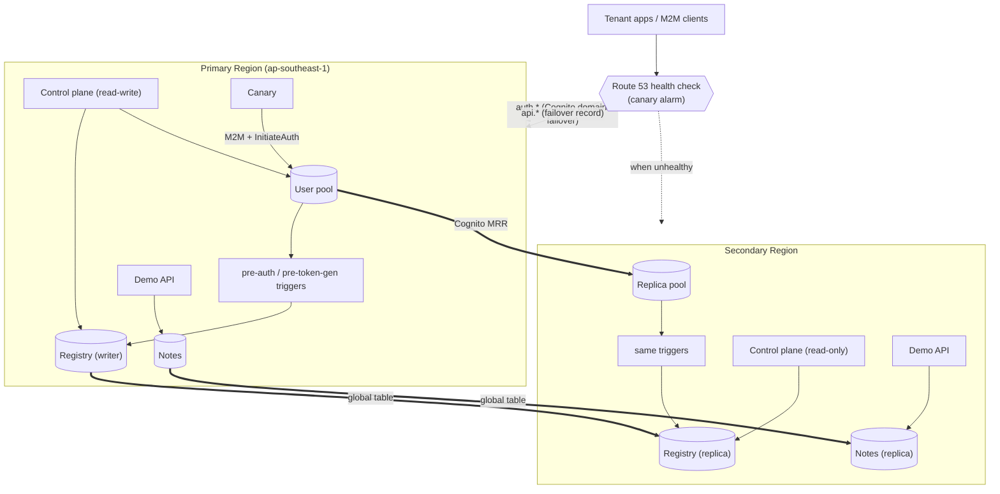

| Layer | Pattern |
|---|---|
| Identity | Active-passive (Cognito multi-Region replication) |
| Token validation | Active-active and stateless (JWT + cached JWKS, no per-request Cognito call) |
| Demo API | Deployed in both Regions; traffic follows the Route 53 failover record |
| Control plane | Writes in the primary only; `503` + `Retry-After` in the secondary or during failover |
| Tenant registry | DynamoDB global table with a single writer |

### Components

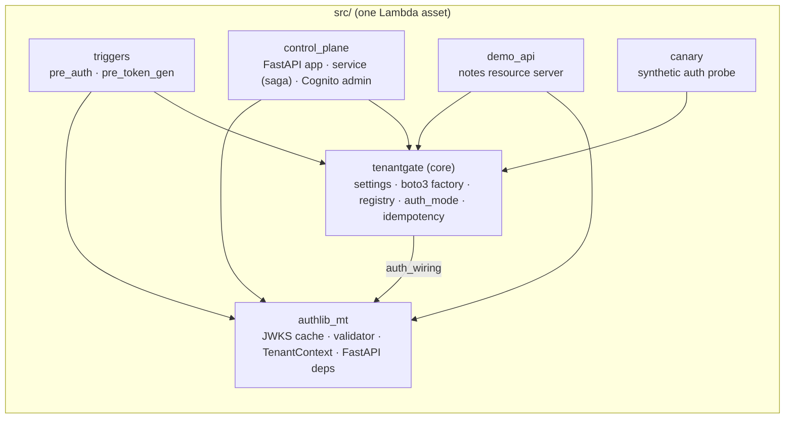

`authlib_mt` depends on nothing in this repo and has no boto3 dependency. The other packages share `tenantgate` for settings, AWS clients and the registry.

## How tenant isolation is enforced

The managed-login session cookie works across every app client in the pool. An app client alone therefore doesn't isolate tenants. tenantgate checks the tenant at three layers:

1. **Pre-authentication trigger.** Rejects sign-in when the client is unknown, the tenant is disabled, the user isn't a member, or an M2M client is used for user sign-in.
2. **Pre-token-generation trigger (V3).** Runs on *every* issuance, including cookie sessions and refreshes, and fails closed.
   - It adds `tenant_id` and `tenant_role` claims.
   - It removes `api/write` from members.
   - It strips tenant-scoped scopes from user tokens and foreign-tenant scopes from M2M tokens.
3. **`authlib_mt`.** Validates the token itself: signature, `iss`, `token_use` and expiry. It then confirms that:
   - `client_id` still maps to the token's tenant, and that tenant is active;
   - the tenant in the path and in `X-Tenant-Id` matches the token.

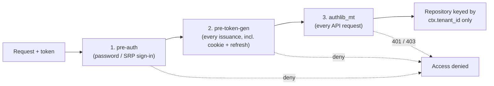

## Flows

### User sign-in (authorization code + PKCE)

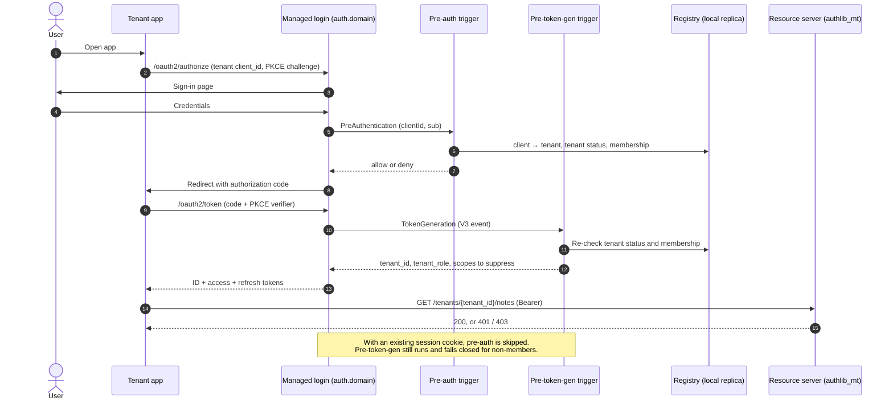

### Machine-to-machine (client credentials)

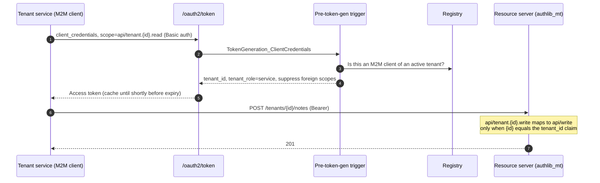

To rotate a secret, the control plane creates a replacement client and gives the old one a `retire_after` time. An hourly job deletes the old client once that grace period has passed.

### Token validation in `authlib_mt`

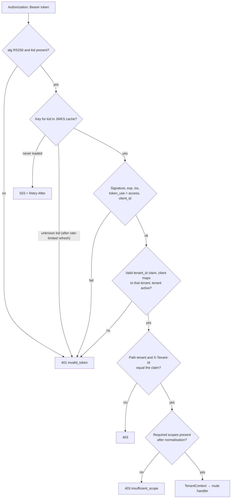

The JWKS cache uses a stale-while-revalidate approach:
- Keys refresh every hour.
- If a refresh fails, the last good key set stays in use.
- An unknown `kid` triggers a refresh, at most once every 30 seconds.

### Tenant onboarding (saga with compensation)

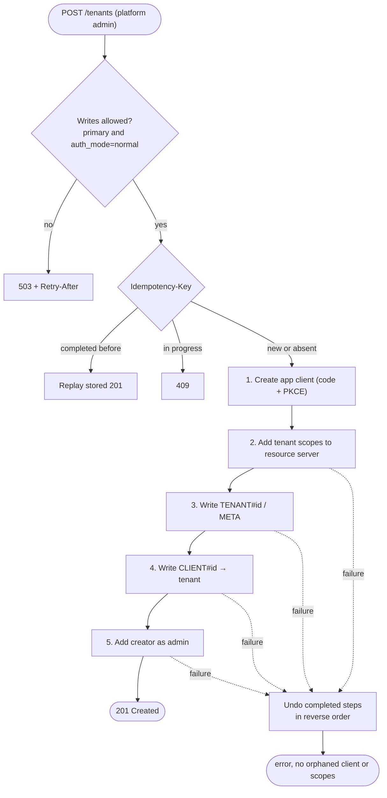

To disable a tenant, the service first sets the status flag, which every check honours immediately. It then turns off OAuth on the tenant's clients. Deleting a tenant works in the same order: mark the tenant `deleting`, delete the clients and scopes, sign out members who belong to no other tenant, then remove the registry rows.

## Data model

All registry data is in one DynamoDB table with one GSI:

| PK | SK | GSI1PK | GSI1SK | Purpose |
|---|---|---|---|---|
| `TENANT#<id>` | `META` | `TENANTS` | `TENANT#<id>` | Tenant record: name, status, plan, client IDs, IdPs, URLs |
| `TENANT#<id>` | `USER#<sub>` | `USER#<sub>` | `TENANT#<id>` | Membership and role (`admin` / `member`) |
| `CLIENT#<client_id>` | `TENANT` | | | Reverse lookup used by triggers and `authlib_mt`. M2M clients also store `actions` and `retire_after` |

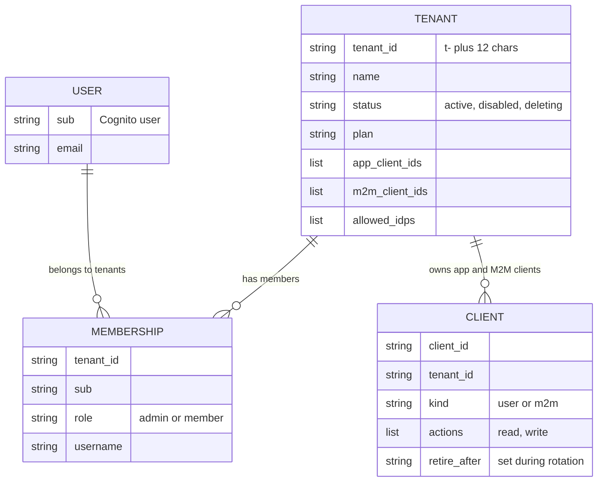

The demo API stores notes in a separate table with `PK = TENANT#<id>` and `SK = NOTE#<id>`. The repository takes the tenant from the `TenantContext`, never from the request body.

## Multi-Region and failover

### Failover sequence

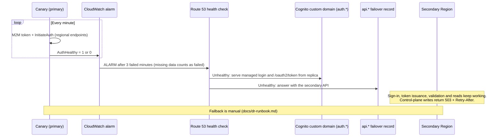

### Degraded mode

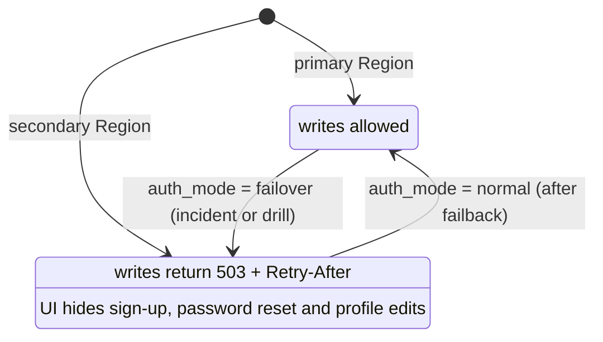

Each Region has its own `auth_mode` flag in SSM Parameter Store. The control plane caches it for 30 seconds and keeps the last known value if SSM can't be reached. The secondary Region never writes, whatever its flag says.

| Under multi-Region replication | How tenantgate handles it |
|---|---|
| Admin and write APIs only work in the primary | The control plane becomes read-only during failover |
| TOTP MFA doesn't work in the secondary | Email MFA only |
| The classic hosted UI isn't supported on replicas | Managed login v2 from day one |
| Changing the issuer later breaks validators | Multi-Region issuer set at creation and pinned with `-c token_issuer` |
| Triggers, WAF, SES and alarms are configured per Region | `regional_stack.py` deploys them in both Regions |
| Lockout counters aren't shared between Regions | Accepted; see the [threat model](docs/threat-model.md) |

## Repository layout

```
src/
  authlib_mt/     JWKS cache, token validator, TenantContext, FastAPI dependencies
  tenantgate/     settings, boto3 factory, registry, degraded-mode flag, idempotency
  triggers/       pre_auth.py, pre_token_gen.py
  control_plane/  tenant lifecycle API (FastAPI + Mangum), Cognito admin wrapper, saga
  demo_api/       sample tenant-partitioned resource server (notes)
  canary/         synthetic auth probe → CloudWatch metric → health check
infra/            CDK app: cert, global (KMS), key-replica, data, identity, regional ×2, dns, ci
scripts/          build_lambda.sh, dr_drill.py, export_openapi.py
docs/             ADRs, DR runbook, threat model, OpenAPI specs (docs/openapi/)
tests/unit        moto + locally signed JWTs; no AWS account needed
tests/integration against a deployed stack (pytest -m integration)
```

## Development

Requires Python 3.12+ and [uv](https://docs.astral.sh/uv/).

```bash
uv sync --group dev --group infra
uv run pytest                                  # unit tests
uv run ruff check src tests infra scripts
uv run mypy                                    # strict
uv run pre-commit install --hook-type pre-commit --hook-type pre-push
```

## Deployment

### Stacks and deploy order

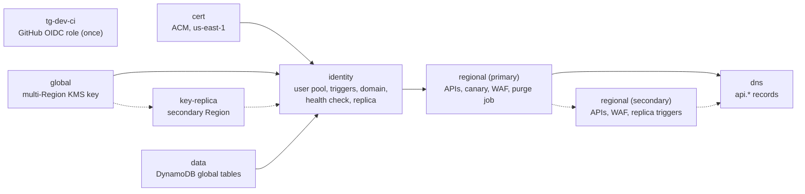

Dashed arrows are only used with `-c multi_region=true`. `cdk deploy --all` follows these dependencies.

### Steps

Prerequisites:

- a public Route 53 hosted zone;
- CDK bootstrapped in the primary Region and in `us-east-1` (the Cognito custom-domain certificate must live there);
- for multi-Region, CDK also bootstrapped in the secondary Region;
- Node.js for the CDK CLI.

```bash
./scripts/build_lambda.sh
cd infra

# Once: GitHub OIDC deploy role (no static AWS keys in CI)
npx aws-cdk deploy tg-dev-ci -c domain_name=example.com -c hosted_zone_id=Z123 \
  -c github_repo=<owner>/tenantgate

# Single-Region dev stack
npx aws-cdk deploy --all -c domain_name=example.com -c hosted_zone_id=Z123 \
  -c admin_callback_urls=https://admin.example.com/callback
```

After the first deploy:

1. **Pin the issuer.** Read `issuer` from `https://cognito-idp.<region>.amazonaws.com/<pool-id>/.well-known/openid-configuration` and redeploy with `-c token_issuer=<issuer>`.
2. **Set up the canary.** Create a canary user that belongs to no tenant, and generate the `system-canary-m2m` client secret. Store both in the `tenantgate/<stage>/canary` secret:

   ```json
   {"m2m_client_id": "…", "m2m_client_secret": "…", "user_client_id": "…", "username": "…", "password": "…"}
   ```

3. **Make yourself an admin.** Add your user to the `platform-admins` group.

To go multi-Region, deploy with `-c multi_region=true`, check the replica's regional configuration, then deploy again with `-c activate_replica=true`. After that, run a drill (see [the DR runbook](docs/dr-runbook.md)).

| Context key | Default | Meaning |
|---|---|---|
| `domain_name` | **required** | Base domain; serves `auth.<domain>` and `api.<domain>` |
| `hosted_zone_id` | **required** | Existing public hosted zone for `domain_name` |
| `stage` | `dev` | `dev` or `prod` (prod keeps data on delete and enables deletion protection) |
| `primary_region` / `secondary_region` | `ap-southeast-1` / `ap-southeast-2` | Regions |
| `multi_region` | `false` | Adds the KMS replica key, table replicas, Cognito replica and secondary Region |
| `activate_replica` | `false` | Sets the Cognito replica to ACTIVE |
| `admin_callback_urls` | `http://localhost:3000/callback` | Comma-separated callback URLs for the control-plane UI client (also used for CORS) |
| `github_repo` | — | `owner/name`; creates the CI deploy role stack |
| `ses_from_email` | — | SES-backed email; required for email MFA |
| `token_issuer` | — | The pinned `iss` every validator accepts |
| `alarm_email` | — | Subscribed to the auth-health alarm |

## API

Full OpenAPI 3.1 documents, generated from the code, cover every request and response schema, auth requirement and error code:

| API | Spec | Base path |
|---|---|---|
| Control plane | [`docs/openapi/control-plane.json`](docs/openapi/control-plane.json) | `https://api.<domain>/control` |
| Demo API | [`docs/openapi/demo-api.json`](docs/openapi/demo-api.json) | `https://api.<domain>/demo` |

To browse them interactively, import a file into [Swagger Editor](https://editor.swagger.io) (File → Import file), or serve them locally:

```bash
docker run --rm -p 8080:8080 -e URLS='[{"url":"/specs/control-plane.json","name":"control plane"},{"url":"/specs/demo-api.json","name":"demo API"}]' \
  -v "$PWD/docs/openapi:/usr/share/nginx/html/specs" swaggerapi/swagger-ui
# then open http://localhost:8080
```

After changing a route or model, regenerate the files with `uv run python scripts/export_openapi.py`. A unit test fails if the committed files are out of date.

### Control plane

Base URL: `https://api.<domain>/control`. Callers must use access tokens from the system client; tenant tokens are rejected.

| Method | Path | Who |
|---|---|---|
| `GET` | `/status` | anyone (Region, `auth_mode`, `writes_allowed`) |
| `GET` | `/me/tenants` | any signed-in operator |
| `POST` | `/tenants` (supports `Idempotency-Key`) | platform admin |
| `GET` | `/tenants` | platform admin |
| `GET` | `/tenants/{id}` | tenant member |
| `PATCH` | `/tenants/{id}` | tenant admin (`status`: platform admin only) |
| `DELETE` | `/tenants/{id}` | platform admin |
| `GET` / `POST` | `/tenants/{id}/members` | tenant admin |
| `PATCH` / `DELETE` | `/tenants/{id}/members/{sub}` | tenant admin (the last admin is protected) |
| `POST` | `/tenants/{id}/m2m-clients` | tenant admin. The secret is returned once. |
| `POST` | `/tenants/{id}/m2m-clients/{client_id}/rotate` | tenant admin. The old client is removed after the grace period. |
| `DELETE` | `/tenants/{id}/m2m-clients/{client_id}` | tenant admin |

Errors: `401` invalid token, `403` missing role, `404` unknown tenant or not a member (existence isn't revealed), `409` conflict (for example, removing the last admin), `422` validation error or a reused `Idempotency-Key` with a different body, `503` read-only mode or Cognito throttling.

### Demo API

Base URL: `https://api.<domain>/demo`. Every response includes `X-Served-Region`.

| Method | Path | Scope |
|---|---|---|
| `GET` | `/health` | — |
| `GET` | `/tenants/{id}/whoami` | any valid token |
| `GET` | `/tenants/{id}/notes[/{note_id}]` | `api/read` |
| `POST` / `PUT` / `DELETE` | `/tenants/{id}/notes[/{note_id}]` | `api/write` |

### Using `authlib_mt` in your own service

```python
from fastapi import Depends, FastAPI
from authlib_mt import JWKSCache, TenantContext, TokenValidator, http_fetcher
from authlib_mt.fastapi import TenantAuth

ISSUER = "https://cognito-idp.ap-southeast-1.amazonaws.com/<pool-id>"
validator = TokenValidator(
    issuers=[ISSUER],
    jwks=JWKSCache(http_fetcher(f"{ISSUER}/.well-known/jwks.json")),
)


class MyDirectory:
    """Anything with these two methods works; tenantgate uses the DynamoDB registry."""

    def tenant_for_client(self, client_id: str) -> str | None: ...
    def is_tenant_active(self, tenant_id: str) -> bool: ...


auth = TenantAuth(validator, MyDirectory())
app = FastAPI()


@app.get("/tenants/{tenant_id}/things")
def things(ctx: TenantContext = Depends(auth.require("api/read"))):
    return {"tenant": ctx.tenant_id, "role": ctx.role, "m2m": ctx.is_m2m}
```

## Testing

- **Unit tests (`tests/unit`).** Cover the triggers with fixture events, token validation with locally signed JWTs and a fake JWKS, the control plane and registry against moto, and the canary, idempotency and degraded-mode logic.
- **Isolation spec.** The negative tests define tenant isolation: expired token, foreign key or pool, tenant A's token on tenant B's route, disabled tenant, removed member, cross-tenant cookie session, and an M2M client asking for another tenant's scope.
- **Integration tests (`tests/integration`).** Run against a deployed stack with `TG_*` environment variables. `scripts/dr_drill.py` runs them against the secondary during a drill.

## Cost notes

- Essentials is billed per monthly active user, and MRR adds a per-MAU charge for the replica Region.
- M2M is billed per app client and per token request, with no free tier. Clients should cache tokens, and the canary runs once a minute.
- Route 53 health checks and canary invocations add small fixed costs.
- Dev stays single-Region by default. Tear it down when you're not using it: `npx aws-cdk destroy --all`.

## Documentation

- [ADR-001: tenancy model](docs/adr/001-tenancy-model.md)
- [ADR-002: multi-Region design](docs/adr/002-multi-region.md)
- [DR runbook](docs/dr-runbook.md)
- [Threat model](docs/threat-model.md)
